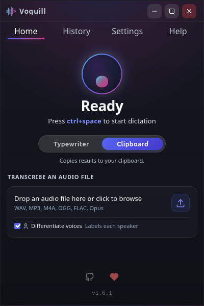
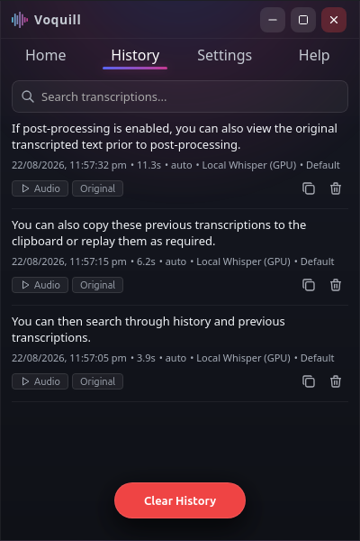
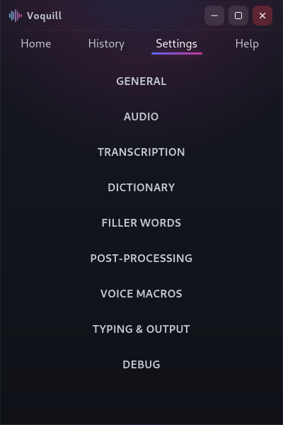
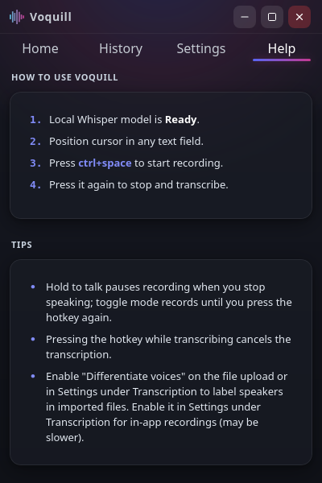

<p align="center">
  
</p>

<h1 align="center">Voquill</h1>

<p align="center">Truly free, open-source offline dictation for Windows, Linux and macOS.<br />Your voice never leaves your computer.</p>

<p align="center">
  <a href="https://github.com/jackbrumley/voquill/releases/latest"></a>
  
  <a href="LICENSE"></a>
</p>

<p align="center">
  <a href="https://voquill.org">Website</a> ·
  <a href="https://github.com/jackbrumley/voquill/releases/latest">Downloads</a> ·
  <a href="docs/FEATURES.md">All features</a> ·
  <a href="https://github.com/jackbrumley/voquill/issues">Report an issue</a>
</p>

## Install

**Linux**

```bash
curl --proto '=https' --tlsv1.2 -sSf https://voquill.org/install.sh | bash
```

**Windows** (PowerShell)

```powershell
irm https://voquill.org/install.ps1 | iex
```

**macOS** (Apple Silicon)

```bash
curl --proto '=https' --tlsv1.2 -sSf https://voquill.org/install.sh | bash
```

Prefer a package? The [latest release](https://github.com/jackbrumley/voquill/releases/latest) has `.exe`, `.msi`, `.deb`, `.rpm`, `.AppImage` and macOS `.zip` files, and the [install guide](docs/INSTALL.md) covers every option. macOS support is community-supported: every release is built and install-tested on Apple Silicon, but the app is not notarized, so use the one-line installer rather than a browser download.

## What it does

Voquill turns your voice into text right where your cursor is. Press the hotkey (<kbd>Ctrl</kbd> + <kbd>Shift</kbd> + <kbd>Space</kbd> by default), speak, press it again, and it types into any app: emails, docs, browsers, editors. It's a free, open-source alternative to paid cloud dictation: everything runs on your own computer, so your voice never leaves it.

- Works in any app, with a global hotkey (toggle or hold-to-talk)
- 100% local and private: speech recognition and AI run on your computer, with no accounts or telemetry
- On-device AI cleans up your dictation: grammar, formatting and your own writing styles
- Voice macros run key sequences, shortcuts and commands from spoken trigger words
- Transcribes audio files and tells different speakers apart
- Truly free: GNU AGPLv3, with no subscriptions, paywalls or "Pro" tier

## Screenshots

<p align="center">
  
  
</p>
<p align="center">
  
  
</p>

[Watch the two-minute video](https://youtu.be/yKKyPUwEpDg)

## Build from source

```bash
npm install
npm run deps:check   # lists anything missing, with the command to install it
npm run tauri:dev    # run in development
npm run tauri:build  # build packages for this platform (macOS: -- --bundles app)
```

Packages land in `src-tauri/target/release/bundle/` (Windows: `C:\vb\release\bundle\`, kept short to avoid path-length limits). Contributor notes are in [AGENTS.md](AGENTS.md).

## License

[GNU AGPLv3](LICENSE). Use it, learn from it and build on it freely; if you improve it, share the changes back.

---

<p align="center">
  Voquill is one of the free apps by <a href="https://brumley.info">Jack Brumley</a>:<br />
  <b>Voquill</b> · <a href="https://brumley.info/rusty-g6/">Rusty G6</a> · <a href="https://somedrive.org/">SomeDrive</a> · <a href="https://yambuck.com/">Yambuck</a> · <a href="https://brumley.info/rawtap/">RawTap</a> · <a href="https://bmuster.com/">BMuster</a>
</p>
